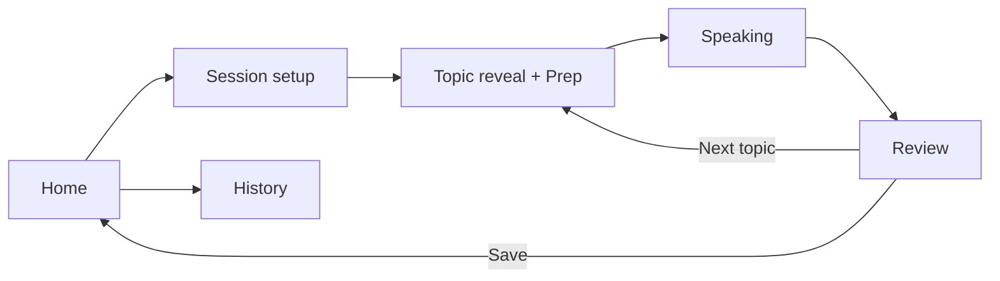

# Stand Up: Design Brief

2026-09-18 · @Someone

## Name and brand

The app is called **Stand Up**. The brand should feel encouraging, warm, a little playful, and never judgmental.

The name carries several meanings the design can lean into:

- Standing up to speak: the app is a stage, and the floor is yours.
- Standing up for yourself: facing nerves and finding your voice.
- A nod to "start up": getting started, momentum, small daily wins.
- A light echo of stand-up comedy: the playful side of practice.

The wordmark and app icon should feel confident but friendly, not corporate. Tagline directions: "The floor is yours." or "Find your words."

## Product summary

Stand Up is a web app for practicing impromptu speaking. The user gets a random topic, has a short prep window, speaks against a timer, then reviews how it went. Going from opening the app to speaking should take under 10 seconds.

**Audience.** Designed first for a single user practicing alone, often on a phone. Later it opens to a wider public (students, job seekers, club members). Design for one person now, but avoid choices that would block onboarding, accounts, and more practice modes later.

**Platform.** Mobile-first responsive web app that also works well on desktop. The user may be standing and holding the phone while speaking, so controls need large tap targets and the timer must be readable from arm's length.

## Core flow and screens

The practice loop runs through six screens, with Review leading back into another round.

### 1. Home

- One dominant "Start practicing" button.
- Quick access to last-used settings ("Same as last time").
- Secondary link to History.
- Optional "Topic of the day" card.

### 2. Session setup

- Topic category, including a "Surprise me" option that mixes categories.
- Difficulty: Easy, Medium, Hard.
- Prep time: 15s, 30s, or 60s. Speaking time: 1, 2, or 3 min.
- Toggle for recording audio.
- Skippable through sensible defaults.

### 3. Topic reveal and Prep

- Topic shown large and centered, readable at a glance.
- Countdown ring or bar for prep time.
- Optional "Structure hint" card (see Articulation focus).
- "Skip topic" (one skip per round) and "Start now" buttons.
- Moves to Speaking automatically when prep ends.

### 4. Speaking

- The timer is the hero element, huge and readable from a distance.
- Timing-light states: green (on track), yellow (nearing the end), red (time's up), shown as a full-screen tint or large indicator the user can see peripherally.
- Topic stays visible but secondary. Recording indicator when recording is on.
- "Finish" button. The timer keeps counting into overtime, shown neutrally ("+0:20"), rather than stopping abruptly.

### 5. Review

- Summary: topic, time spoken, over or under target.
- Playback of the recording, with a delete option.
- Self-rating (1 to 5) on Structure, Clarity, Confidence, and Filler words, plus an optional notes field.
- Feedback card, on demand, in five states: empty, ready to run, loading, ready and offline. Ships at M2.5; see the handoff for the counted/written split.
- Actions: "Next topic" (primary) and "Save and go home."

### 6. History

- List of past sessions: date, topic, duration, self-ratings.
- Simple trend view, such as average ratings over time and sessions per week.
- Tap a session to reopen its Review screen, or delete it.

## States, visual direction, and accessibility

**States to design**

- First-time use with no history: friendly empty states on Home and History.
- Microphone permission requested and denied, with a way to continue without recording.
- Overtime during Speaking.
- Feedback card: empty, ready to run, loading, ready, offline.
- Delete confirmation for a recording or session.
- Reduced-motion variant of countdown animations.

**Visual direction**

- Chosen direction: Calm studio. Calm, focused, and confidence-building, a practice space rather than a test. Warm off-white background, sage green accents, deep green-gray text, a serif typeface for topic text with a clean sans for the UI, and the timer drawn as a sage ring. Timing lights use softened, muted versions of green, yellow, and red so they stay clear without feeling alarming.
- Minimal chrome during Prep and Speaking, with distractions removed.
- Strong typographic hierarchy: the topic and timer carry the screen.
- Timing-light colors paired with a shape, label, or position, so they work for color-blind users.
- Light and dark mode.

**Accessibility**

- Tap targets at least 44px.
- High contrast for timer and topic text.
- Screen-reader announcements for phase changes: prep started, speaking started, time's up.

## Tone and articulation

**Tone and feedback principles.** The app should feel like a safe practice space where users can express themselves without being judged.

- Lead every review with what went well before suggesting anything.
- Offer one focus for next time, not a list of mistakes.
- Avoid grades, red X's, or failure language. Use "Try next time" rather than "Errors."
- Show overtime neutrally, not as a warning.
- Welcome playful touches: a light celebration after finishing, friendly empty states, humor in the copy.

**Articulation focus.** The first user's goal is to become more articulate: clear structure, precise word choice, and fewer fillers.

- Prep screen: optional "Structure hint" card showing the PREP framework (Point, Reason, Example, Point) as a gentle guide.
- Feedback flags vague words in the transcript ("stuff," "things," "kind of," "basically"), counts filler words, and notices unfinished or trailing sentences. These two word lists are fixed and matched in plain code — they are the spec for the counted half, so keep them here and in sync with the app.
- It also rewrites one sentence from the user's own transcript more crisply: "You said... A sharper version: ..."

## Topics

There are seven categories plus "Surprise me": General, Tech, Society & Politics, Games, Movies, Interview Questions, and Wildcard. Politics topics stay civic and non-partisan so the app feels welcoming. Use these samples as real content in the designs, including the longer ones, to test text wrapping.

| Category | Topic | Difficulty |
| --- | --- | --- |
| General | What's a small thing that instantly makes your day better? | Easy |
| General | Pineapple on pizza: defend your position. | Easy |
| General | Is it better to be early or exactly on time? | Medium |
| General | What's a skill everyone should learn before 25? | Medium |
| General | What does "success" mean to you, and has that changed? | Hard |
| Tech | Tabs or spaces? Argue it like a courtroom lawyer. | Easy |
| Tech | Explain "the cloud" to someone who's never used a computer. | Easy |
| Tech | Describe a bug that taught you something. | Medium |
| Tech | What piece of tech would you un-invent if you could? | Medium |
| Tech | Should AI be allowed to make hiring decisions? | Hard |
| Society & Politics | If you ran your city for one day, what would you change first? | Easy |
| Society & Politics | Should voting be mandatory? | Medium |
| Society & Politics | Should the voting age be lowered to 16? | Medium |
| Society & Politics | What's one law you think is outdated? | Medium |
| Society & Politics | How should a country balance privacy and security? | Hard |
| Games | Pitch a board game based on your daily commute. | Easy |
| Games | Which game world would you want to live in, and why? | Easy |
| Games | Are video games art? | Medium |
| Games | Teach the rules of your favorite game in one minute. | Medium |
| Games | Should competitive gaming be an Olympic sport? | Hard |
| Movies | Pitch a sequel nobody asked for. | Easy |
| Movies | Which movie villain actually had a point? | Medium |
| Movies | Is the book always better than the movie? | Medium |
| Movies | What movie would you show an alien to explain humans? | Medium |
| Movies | Recommend a movie without mentioning its plot. | Hard |
| Interview Questions | Tell me about yourself. | Easy |
| Interview Questions | Describe a time you disagreed with a teammate. | Medium |
| Interview Questions | What's a weakness you're actively working on? | Medium |
| Interview Questions | Explain a technical concept to a non-technical manager. | Hard |
| Interview Questions | Why should we hire you over someone with more experience? | Hard |
| Wildcard | Give a toast at the wedding of two houseplants. | Easy |
| Wildcard | Convince me that Mondays are secretly the best day. | Easy |
| Wildcard | You're a pigeon giving a TED talk. Go. | Medium |
| Wildcard | Sell me this pen, but it's the last pen on Earth. | Medium |
| Wildcard | Explain where socks disappear to in the laundry, with evidence. | Medium |

## Privacy and data

Users can delete their recordings and data whenever they want.

- Recordings are stored on the user's device by default.
- Any single recording can be deleted from its Review screen or from History.
- Settings includes "Delete all recordings" and "Delete all data."
- Users can delete the audio but keep ratings and notes, so progress history isn't lost.
- Deletion asks for confirmation and states clearly that it's permanent.
- In Phase 5, when accounts sync data, deleting removes it from the server too.

## Scope and deliverables

**Deliverables for this design pass:** mobile screens for all six screens and the listed states, plus desktop layouts for Speaking and Review. Start with Topic reveal and Speaking, since they carry the whole experience.

**Out of scope for now:** account creation and login, social features and sharing, leaderboards, and payment or pricing screens. Leave room in navigation for these to be added later.

## Product roadmap

This design pass covers Phases 1 and 2. Phases 3 to 5 are context only: don't design them yet, but make layout and navigation choices that leave room for them.

| Phase | Focus | What it adds | Design implication |
| --- | --- | --- | --- |
| 1 (now) | Core practice loop | Topic generator with categories and difficulty, prep countdown, speaking timer with timing lights, next-topic flow. Runs entirely in the browser with no accounts. | The six screens in this brief. |
| 2 (now) | Recording, self-review and feedback | In-browser recording and playback, self-ratings, notes, session history on the device. Then transcription, filler and vague-word flags, words per minute, and one sharper rewrite of the user's own sentence. | Review and History screens, delete controls, and the feedback card's five states. |
| 3 | Better writing | A stronger model behind the written half if the open-weight one proves too bland. AI-generated topics on demand. | No new layout; the card already holds it. |
| 4 | Progress and habit | Trends over time, streaks, a daily topic, and practice modes (Job interview, Debate, Toasts, Storytelling). | Home should grow from one big button into a dashboard without a redesign. |
| 5 | Wider audience launch | Onboarding that asks about goals, optional accounts that sync across devices, clear privacy messaging for recordings. | Navigation needs room for a profile and settings area and an onboarding entry point. |
